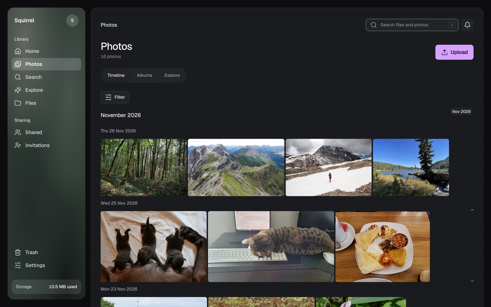
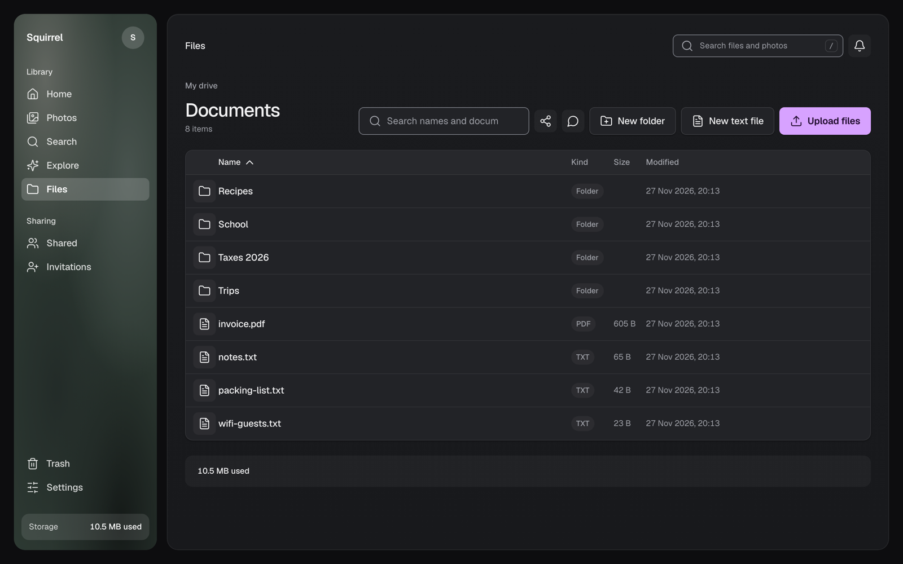
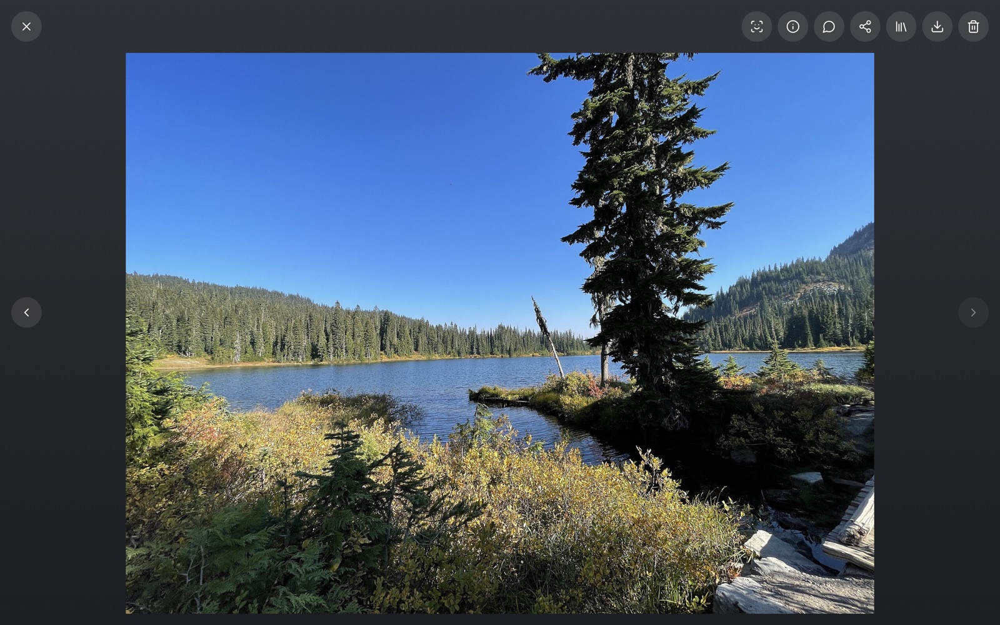
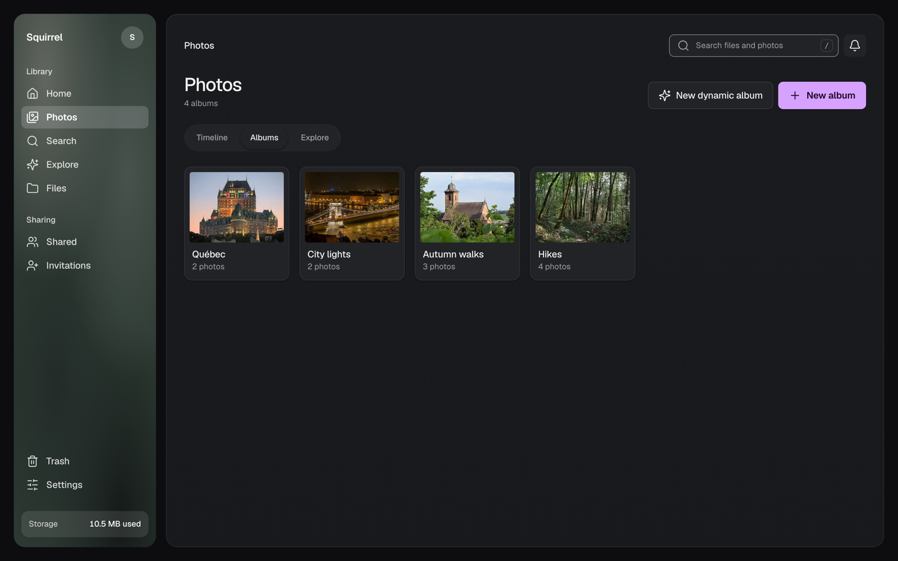
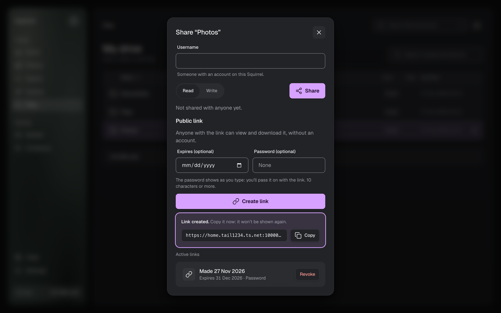
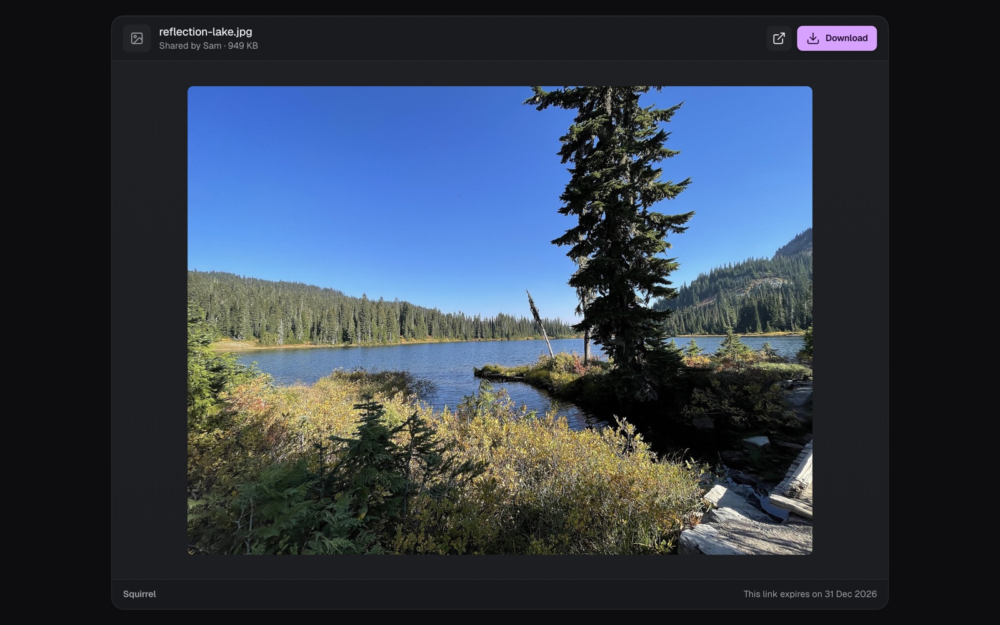
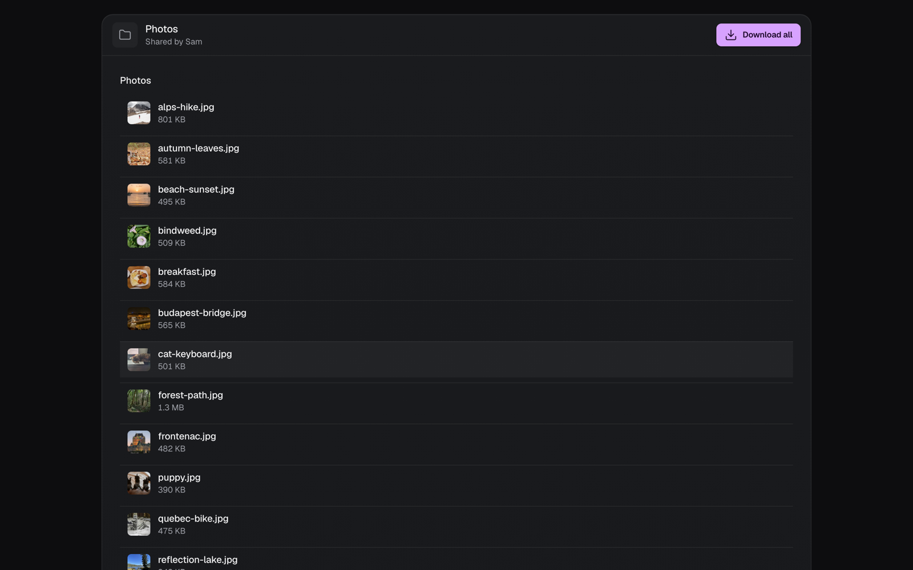

# Squirrel

**A home drive you run yourself.** Squirrel keeps your family's files and photos on a small
computer at home: a web app to browse, search and share them, and a phone app that backs up
your camera roll. Nothing leaves the house unless you share it, not even to recognise faces
or understand what is in a photo.

## What it does

**Files.** Folders, uploads of any size (resumed after a lost connection), rename, move, and a
trash that keeps things 30 days. Images, videos, PDFs and text open in the browser; text files
can be edited by several people at once. Each user has their own space, with an optional
quota.

**Photos.** Every photo and video in your drive lands on one timeline, grouped by month and day,
with the date, camera and place they were taken (places come from an offline map, no request
leaves the server). Albums you fill by hand, or that fill themselves from a rule ("everything
from Québec in 2026"). Near-identical copies are found and grouped so you can keep the best
one. HEIC photos from iPhones are supported.

**Search that understands photos.** Photos are tagged ("beach", "dog", "snow") and
searchable by what they show, in any language ("dog on the beach", "chien sur la plage").
Faces are grouped into people you can name. It all runs on the server's own processor, and
each user can turn faces off.

**Search in documents.** File names, PDFs and text files are searched by their content.

**Sharing.** Share a folder or an album with others on the server, to read or to edit, and
comment on photos together; notifications tell you when something is shared with you or
commented on. To share with someone who has no account, make a **public link** to a folder,
a file or an album, with an optional expiry date and password. Links are served through
[Tailscale Funnel](https://tailscale.com/kb/1223/funnel), on a separate address that opens
nothing but the link pages.

| A shared photo | A shared folder |
| --- | --- |
|  |  |

**Phone app.** An Android and iOS app backs up your camera roll in the background. It only ever
adds: deleting a photo on the phone never deletes it from the server. Each phone can be
signed out from the web.

**Private by design.** Invitation-only accounts, everything served over HTTPS inside your
[Tailscale](https://tailscale.com) network, files stored once however many times they are
uploaded, and untrusted files decoded in sandboxed processes with memory and time limits.

## Install

Squirrel runs on a Linux mini PC or any always-on machine with Docker: one image runs the web
server and the background worker next to Postgres.

1. Follow [`deploy/README.md`](deploy/README.md): prepare the server, create the settings
   file, and run `deploy/ship.sh <ssh-host>` from your computer to build and start everything.
2. Open the address Tailscale gives the server, enter the setup code from the settings file,
   and create the administrator account.
3. Invite everyone else from Settings › Invitations, and install the phone app
   ([`mobile/README.md`](mobile/README.md)).

The image comes with everything, machine learning models included; nothing is downloaded at
run time. Public links are optional: the deploy guide covers them.

## Documentation

| | |
| --- | --- |
| [`deploy/README.md`](deploy/README.md) | Installing on a home server, updates, backups, public links |
| [`docs/configuration.md`](docs/configuration.md) | Every setting, the data directory, administration, media processing and machine learning |
| [`docs/development.md`](docs/development.md) | Running from source, tests, the phone app build, the API contract |
| [`MASTER.md`](MASTER.md) | The design system |
| [`docs/plans/`](docs/plans/) | Design documents, one per feature |

## Built with

Rust ([axum](https://github.com/tokio-rs/axum), [sqlx](https://github.com/launchbadge/sqlx)) and
Postgres with [pgvector](https://github.com/pgvector/pgvector) on the server;
[Svelte](https://svelte.dev) for the web app, built into the server binary; Kotlin
Multiplatform and Compose for the phone app; [ONNX Runtime](https://onnxruntime.ai) with
SigLIP2, YuNet and SFace for machine learning; libvips, libheif and pdfium for previews.

The screenshots show public-domain photos from Wikimedia Commons
([sources](docs/screenshots/SOURCES.md)).
